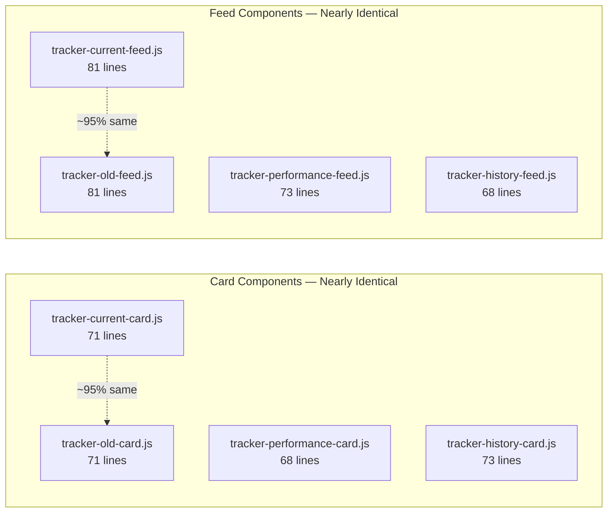

# 📊 Tracker Feature — Complete Audit Report

## 1. Directory Structure Overview

```
features/tracker/                          (Root — 4 JS + 1 HTML)
├── tracker-service.js                     ← Centralized service layer
├── tracker-registration.js                ← Component registration
├── tracker.js                             ← Root ViewModel & global bridge
├── tracker-mobile-view.html               ← Mobile view template (with inlined header & nav tabs)
├── tracker-current/                       (1 ViewModel + 3 components)
│   ├── tracker-current.js                 ← Current ViewModel & modular re-exports
│   ├── tracker-current-card/
│   ├── tracker-current-feed/
│   └── tracker-current-form/
├── tracker-old/                           (1 barrel + 4 components)
│   ├── tracker-old.js                     ← Barrel re-export only
│   ├── tracker-old-page/
│   ├── tracker-old-card/
│   ├── tracker-old-feed/
│   └── tracker-old-form/
├── tracker-performance/                   (1 barrel + 3 components + 2 HTML)
│   ├── tracker-performance.js             ← Barrel & template re-exports
│   ├── prayer-perf-ring.html              ← Performance progress ring template
│   ├── prayer-stat-card.html              ← Performance stats cards template
│   ├── tracker-performance-page/
│   ├── tracker-performance-card/
│   └── tracker-performance-feed/
└── tracker-history/                       (1 barrel + 3 components)
    ├── tracker-history.js                 ← Barrel & template re-exports
    ├── tracker-history-page/
    ├── tracker-history-card/
    └── tracker-history-feed/
```

---

## 2. File-Level Summary

| # | File | Lines | Functions | Methods (on `self`) | Total |
|---|------|------:|----------:|--------------------:|------:|
| 1 | [tracker-service.js](file:///Users/apps/js-apps/islam-traker/features/tracker/tracker-service.js) | 419 | **20** | 0 | **20** |
| 2 | [tracker-registration.js](file:///Users/apps/js-apps/islam-traker/features/tracker/tracker-registration.js) | 110 | **1** | 0 | **1** |
| 3 | [tracker.js](file:///Users/apps/js-apps/islam-traker/features/tracker/tracker.js) | 478 | **17** | **8** | **25** |
| 4 | [tracker-current.js](file:///Users/apps/js-apps/islam-traker/features/tracker/tracker-current/tracker-current.js) | 254 | **1** | **9** | **10** |
| 5 | [tracker-current-card.js](file:///Users/apps/js-apps/islam-traker/features/tracker/tracker-current/tracker-current-card/tracker-current-card.js) | 71 | **1** | **1** | **2** |
| 6 | [tracker-current-feed.js](file:///Users/apps/js-apps/islam-traker/features/tracker/tracker-current/tracker-current-feed/tracker-current-feed.js) | 81 | **1** | **3** | **4** |
| 7 | [tracker-current-form.js](file:///Users/apps/js-apps/islam-traker/features/tracker/tracker-current/tracker-current-form/tracker-current-form.js) | 81 | **1** | **5** | **6** |
| 9 | [tracker-old-page.js](file:///Users/apps/js-apps/islam-traker/features/tracker/tracker-old/tracker-old-page/tracker-old-page.js) | 253 | **2** | **10** | **12** |
| 10 | [tracker-old-card.js](file:///Users/apps/js-apps/islam-traker/features/tracker/tracker-old/tracker-old-card/tracker-old-card.js) | 71 | **1** | **1** | **2** |
| 11 | [tracker-old-feed.js](file:///Users/apps/js-apps/islam-traker/features/tracker/tracker-old/tracker-old-feed/tracker-old-feed.js) | 81 | **1** | **3** | **4** |
| 12 | [tracker-old-form.js](file:///Users/apps/js-apps/islam-traker/features/tracker/tracker-old/tracker-old-form/tracker-old-form.js) | 148 | **1** | **5** | **6** |
| 13 | [tracker-old.js](file:///Users/apps/js-apps/islam-traker/features/tracker/tracker-old/tracker-old.js) | 9 | 0 | 0 | **0** |
| 14 | [tracker-performance-page.js](file:///Users/apps/js-apps/islam-traker/features/tracker/tracker-performance/tracker-performance-page/tracker-performance-page.js) | 120 | **1** | **2** | **3** |
| 15 | [tracker-performance-card.js](file:///Users/apps/js-apps/islam-traker/features/tracker/tracker-performance/tracker-performance-card/tracker-performance-card.js) | 68 | **1** | **1** | **2** |
| 16 | [tracker-performance-feed.js](file:///Users/apps/js-apps/islam-traker/features/tracker/tracker-performance/tracker-performance-feed/tracker-performance-feed.js) | 73 | **1** | **2** | **3** |
| 17 | [tracker-performance.js](file:///Users/apps/js-apps/islam-traker/features/tracker/tracker-performance/tracker-performance.js) | 8 | 0 | 0 | **0** |
| 18 | [tracker-history-page.js](file:///Users/apps/js-apps/islam-traker/features/tracker/tracker-history/tracker-history-page/tracker-history-page.js) | 108 | **2** | **4** | **6** |
| 19 | [tracker-history-card.js](file:///Users/apps/js-apps/islam-traker/features/tracker/tracker-history/tracker-history-card/tracker-history-card.js) | 73 | **1** | **1** | **2** |
| 20 | [tracker-history-feed.js](file:///Users/apps/js-apps/islam-traker/features/tracker/tracker-history/tracker-history-feed/tracker-history-feed.js) | 68 | **1** | **1** | **2** |
| 21 | [tracker-history.js](file:///Users/apps/js-apps/islam-traker/features/tracker/tracker-history/tracker-history.js) | 8 | 0 | 0 | **0** |
| | **TOTALS** | **2,563** | **54** | **56** | **110** |

> [!NOTE]
> **"Functions"** = exported/standalone `function` declarations. **"Methods"** = functions assigned to `self.*` inside a ViewModel constructor. Barrel re-export files (e.g. `tracker-current.js`) contain zero logic.

---

## 3. Detailed Function & Method Inventory

### 3.1 — [tracker-service.js](file:///Users/apps/js-apps/islam-traker/features/tracker/tracker-service.js) (20 functions)

| # | Name | Line | Category | Purpose |
|---|------|------|----------|---------|
| 1 | `unwrap` | L54 | Utility | Safely unwrap KO observables or functions |
| 2 | `td` | L59 | Date Utility | Returns today's date as `YYYY-MM-DD` |
| 3 | `fr` | L67 | Date Utility | Formats date to "Day, D Month Year" |
| 4 | `formatPrayerDate` | L83 | Date Utility | Formats date to "Mon D, Year" |
| 5 | `datesInRange` | L98 | Date Utility | Returns array of dates between start/end |
| 6 | `formatTimeAgo` | L115 | Date Utility | Relative time string ("5m ago", "2h ago") |
| 7 | `getStoredRecords` | L132 | Storage | Read JSON records from localStorage |
| 8 | `saveStoredRecords` | L144 | Storage | Write JSON records to localStorage |
| 9 | `getPrayerStartDate` | L153 | Storage | Read prayer tracking start date |
| 10 | `isDonePrayer` | L162 | Status | Check if a prayer is completed |
| 11 | `isPrayerUpcoming` | L176 | Status | Check if a prayer hasn't occurred yet |
| 12 | `isPrayerCurrent` | L189 | Status | Check if a prayer is happening now |
| 13 | `getPrayerHistory` | L196 | History | Read prayer history from store/localStorage |
| 14 | `savePrayerHistory` | L211 | History | Persist prayer history array |
| 15 | `addPrayerHistoryEntry` | L226 | History | Add a new history entry (deduped) |
| 16 | `removePrayerHistoryEntry` | L249 | History | Remove entry by ID or by (prayer, type, date) |
| 17 | `clearPrayerHistory` | L264 | History | Delete all history entries |
| 18 | `calculatePrayerPerformance` | L269 | Performance | Full performance stats with per-prayer breakdown |
| 19 | `getMissedPrayersByDate` | L341 | Missed | Returns missed prayers grouped by date |
| 20 | `getTotalMissedCount` | L363 | Missed | Returns total number of missed prayers |

### 3.2 — [tracker-registration.js](file:///Users/apps/js-apps/islam-traker/features/tracker/tracker-registration.js) (1 function)

| # | Name | Line | Purpose |
|---|------|------|---------|
| 1 | `registerTrackerComponents` | L63 | Registers all 20+ Knockout components and backward-compat aliases |

### 3.3 — [tracker.js](file:///Users/apps/js-apps/islam-traker/features/tracker/tracker.js) (17 functions + 8 ViewModel methods)

**Standalone Functions:**

| # | Name | Line | Purpose |
|---|------|------|---------|
| 1 | `PrayerRowViewModel` | L44 | ViewModel constructor for prayer row cards |
| 2 | `PrayerTrackerCardViewModel` | L75 | ViewModel constructor for tracker cards |
| 3 | `getTrackerViewModel` | L104 | Singleton getter for root tracker ViewModel |
| 4 | `TrackerPageViewModel` | L111 | Root page ViewModel constructor |
| 5 | `setOldSd` | L235 | Set old tracking selected date |
| 6 | `getDefaultOldPeriod` | L240 | Generate default 30-day old period |
| 7 | `$` (local) | L259 | DOM element query helper |
| 8 | `missTile` (local) | L266 | Render HTML tile for a missed prayer |
| 9 | `missCard` (local) | L277 | Render HTML card for a missed-day group |
| 10 | `rMS` | L298 | Open Missed Prayers bottom sheet |
| 11 | `rn` | L343 | Refresh current page + badges |
| 12 | `go` | L351 | Navigate to a specific date |
| 13 | `updateCurrentMissedBadge` | L358 | Update missed badge count in DOM |
| 14 | `rOldInfo` | L375 | Switch to Old tab |
| 15 | `rPeriod` | L382 | Alias for `rOldInfo` |
| 16 | `openOldCal` | L386 | Open old date-picker |
| 17 | `goOld` | L394 | Navigate Old tab to a date |
| — | `rOT` | L399 | Refresh Old tab |
| — | `emptyPrayerHistory` | L405 | Clear all history & refresh |
| — | `initTracker` | L411 | Bootstrap tracker feature |

**Methods on `TrackerPageViewModel.self`:**

| # | Method | Purpose |
|---|--------|---------|
| 1 | `self.header.goHome` | Navigate to dashboard |
| 2 | `self.header.openMissed` | Open missed sheet |
| 3 | `self.header.openPeriodInfo` | Open period info |
| 4 | `self.header.emptyHistory` | Empty prayer history |
| 5 | `self.switchTab` | Switch between subtabs |
| 6 | `self.goToSettings` | Navigate to settings |
| 7 | `self.currentParams.onSelectDate` | Open calendar |
| 8 | `self.oldParams.onSelectDate` | Open old calendar |

### 3.4 — [tracker-current.js](file:///Users/apps/js-apps/islam-traker/features/tracker/tracker-current/tracker-current.js) (1 constructor + 9 methods)

| # | Method | Purpose |
|---|--------|---------|
| 1 | `TrackerCurrentPageViewModel` | Constructor |
| 2 | `self.refresh` | Rebuild rows from storage |
| 3 | `self.handleTogglePrayer` | Toggle prayer done/missed |
| 4 | `self.handleDateChipClick` | Open calendar |
| 5 | `self.handleBadgeClick` | Jump to today |
| 6 | `self.handleActionBtnClick` | Select All / Reset All |
| 7 | `self.openMissedForm` | Open missed form |
| 8 | `self.closeMissedForm` | Close missed form |
| — | `obs` (inner) | Observable factory |
| — | `obsArr` (inner) | Observable array factory |
| — | `isObservable` (inner) | Observable check |

### 3.5 — [tracker-current-card.js](file:///Users/apps/js-apps/islam-traker/features/tracker/tracker-current/tracker-current-card/tracker-current-card.js) (1 constructor + 1 method)

| # | Name | Purpose |
|---|------|---------|
| 1 | `TrackerCurrentCardViewModel` | Constructor |
| 2 | `self.onToggle` | Dispatch toggle to parent |

### 3.6 — [tracker-current-feed.js](file:///Users/apps/js-apps/islam-traker/features/tracker/tracker-current/tracker-current-feed/tracker-current-feed.js) (1 constructor + 3 methods)

| # | Name | Purpose |
|---|------|---------|
| 1 | `TrackerCurrentFeedViewModel` | Constructor |
| 2 | `self.hasMissed` | Check if missed rows exist |
| 3 | `self.hasDone` | Check if done rows exist |
| 4 | `self.handleToggle` | Dispatch toggle to page |

### 3.7 — [tracker-current-form.js](file:///Users/apps/js-apps/islam-traker/features/tracker/tracker-current/tracker-current-form/tracker-current-form.js) (1 constructor + 5 methods)

| # | Name | Purpose |
|---|------|---------|
| 1 | `TrackerCurrentFormViewModel` | Constructor |
| 2 | `self.refresh` | Reload missed items |
| 3 | `self.formatDate` | Date formatting delegate |
| 4 | `self.getPrayerIcon` | Icon lookup |
| 5 | `self.handleResolve` | Resolve a missed prayer |
| 6 | `self.handleClose` | Close form |

### 3.8 — [tracker-old-page.js](file:///Users/apps/js-apps/islam-traker/features/tracker/tracker-old/tracker-old-page/tracker-old-page.js) (2 functions + 10 methods)

| # | Name | Purpose |
|---|------|---------|
| 1 | `TrackerOldPageViewModel` | Constructor |
| 2 | `rOT` (standalone) | Refresh Old tab |
| 3 | `self.getPeriod` | Get old tracking period |
| 4 | `self.getOldRecords` | Get old records |
| 5 | `self.refresh` | Rebuild old page rows |
| 6 | `self.handleTogglePrayer` | Toggle prayer state |
| 7 | `self.handleDateChipClick` | Open date picker |
| 8 | `self.handleBadgeClick` | Open period form |
| 9 | `self.handleActionBtnClick` | Select All / Reset All |
| 10 | `self.handleSavePeriod` | Save new period |
| 11 | `self.closePeriodForm` | Close period form |

### 3.9 — [tracker-old-card.js](file:///Users/apps/js-apps/islam-traker/features/tracker/tracker-old/tracker-old-card/tracker-old-card.js) (1 constructor + 1 method)

| # | Name | Purpose |
|---|------|---------|
| 1 | `TrackerOldCardViewModel` | Constructor |
| 2 | `self.onToggle` | Dispatch toggle to parent |

### 3.10 — [tracker-old-feed.js](file:///Users/apps/js-apps/islam-traker/features/tracker/tracker-old/tracker-old-feed/tracker-old-feed.js) (1 constructor + 3 methods)

| # | Name | Purpose |
|---|------|---------|
| 1 | `TrackerOldFeedViewModel` | Constructor |
| 2 | `self.hasMissed` | Check missed rows |
| 3 | `self.hasDone` | Check done rows |
| 4 | `self.handleToggle` | Dispatch toggle |

### 3.11 — [tracker-old-form.js](file:///Users/apps/js-apps/islam-traker/features/tracker/tracker-old/tracker-old-form/tracker-old-form.js) (1 constructor + 5 methods)

| # | Name | Purpose |
|---|------|---------|
| 1 | `TrackerOldFormViewModel` | Constructor |
| 2 | `self.refresh` | Recalculate period stats |
| 3 | `self.toggleEditMode` | Toggle edit/view mode |
| 4 | `self.handleSavePeriod` | Save updated period |
| 5 | `self.handleClose` | Close form |
| 6 | `self.handleBackdropClick` | Close on backdrop |

### 3.12 — [tracker-performance-page.js](file:///Users/apps/js-apps/islam-traker/features/tracker/tracker-performance/tracker-performance-page/tracker-performance-page.js) (1 constructor + 2 methods)

| # | Name | Purpose |
|---|------|---------|
| 1 | `TrackerPerformancePageViewModel` | Constructor |
| 2 | `self.refresh` | Recalculate performance stats |
| 3 | `self.goToSettings` | Navigate to settings |

### 3.13 — [tracker-performance-card.js](file:///Users/apps/js-apps/islam-traker/features/tracker/tracker-performance/tracker-performance-card/tracker-performance-card.js) (1 constructor + 1 method)

| # | Name | Purpose |
|---|------|---------|
| 1 | `TrackerPerformanceCardViewModel` | Constructor |
| 2 | `self.handleClick` | Dispatch card click |

### 3.14 — [tracker-performance-feed.js](file:///Users/apps/js-apps/islam-traker/features/tracker/tracker-performance/tracker-performance-feed/tracker-performance-feed.js) (1 constructor + 2 methods)

| # | Name | Purpose |
|---|------|---------|
| 1 | `TrackerPerformanceFeedViewModel` | Constructor |
| 2 | `self.handleSettingsClick` | Navigate to settings |
| 3 | `self.handleCardClick` | Dispatch card click |

### 3.15 — [tracker-history-page.js](file:///Users/apps/js-apps/islam-traker/features/tracker/tracker-history/tracker-history-page/tracker-history-page.js) (2 functions + 4 methods)

| # | Name | Purpose |
|---|------|---------|
| 1 | `TrackerHistoryPageViewModel` | Constructor |
| 2 | `renderPrayerHistoryTab` (standalone) | Refresh history tab |
| 3 | `self.updateSubtitle` | Update count label |
| 4 | `self.refresh` | Reload history entries |
| 5 | `self.handleDeleteEntry` | Delete a single entry |
| 6 | `self.clearAll` | Clear entire history |

### 3.16 — [tracker-history-card.js](file:///Users/apps/js-apps/islam-traker/features/tracker/tracker-history/tracker-history-card/tracker-history-card.js) (1 constructor + 1 method)

| # | Name | Purpose |
|---|------|---------|
| 1 | `TrackerHistoryCardViewModel` | Constructor |
| 2 | `self.handleDelete` | Dispatch delete |

### 3.17 — [tracker-history-feed.js](file:///Users/apps/js-apps/islam-traker/features/tracker/tracker-history/tracker-history-feed/tracker-history-feed.js) (1 constructor + 1 method)

| # | Name | Purpose |
|---|------|---------|
| 1 | `TrackerHistoryFeedViewModel` | Constructor |
| 2 | `self.handleDeleteEntry` | Dispatch delete |

---

## 4. Grand Totals

| Metric | Count |
|--------|------:|
| **Total JS files** | 21 |
| **Total HTML files** | 17 (8 templates + 9 component templates) |
| **Total Lines of JS** | **2,563** |
| **Barrel re-export files (zero logic)** | 4 |
| **Standalone / exported functions** | **54** |
| **ViewModel methods (on `self`)** | **56** |
| **Grand total functions + methods** | **110** |
| **Window globals assigned** | ~40+ |

---

## 5. Duplication & Centralisation Analysis

> [!WARNING]
> ### Significant Duplication Found

### 5.1 — Pattern Duplication (Copy-Paste Components)

The following groups are **near-identical clones** of each other, differing only in variable names and 1–2 lines of logic:



| Duplicated Pattern | Files Affected | Lines Wasted |
|---|---|---:|
| **Card ViewModel** (icon parsing, unwrap, toggle dispatch) | 4 card files | ~210 lines |
| **Feed ViewModel** (obs/obsArr factory, missed/done arrays, hasMissed/hasDone, handleToggle) | 4 feed files | ~230 lines |
| **Page ViewModel** (obs/obsArr factory, refresh loop, handleTogglePrayer, handleDateChipClick, handleBadgeClick, handleActionBtnClick) | 2 page files (current + old) | ~200 lines |
| **`obs()` / `obsArr()` helper** — redefined identically in **10 files** | 10 files | ~60 lines |
| **Icon sanitisation regex** — duplicated in **5 files** | 5 files | ~50 lines |
| **Total estimated duplicated code** | | **~750 lines (≈29%)** |

### 5.2 — Specific Redundancies

| Issue | Where | Impact |
|-------|-------|--------|
| `obs()` / `obsArr()` helper is copy-pasted into **every** ViewModel | 10 files | Should be in `tracker-service.js` |
| Icon HTML→class sanitisation logic (regex matching) is repeated in **5** card/row constructors | current-card, old-card, perf-card, history-card, tracker.js PrayerRowViewModel | Should be a single `sanitizeIcon()` function |
| `rOT()` function is defined in **both** `tracker.js` (L399) and `tracker-old-page.js` (L237) | 2 files | Should exist in **one** place only |
| `tracker-current-feed` and `tracker-old-feed` are 95% identical | 2 files | Should be a single `TrackerFeedViewModel` parameterized by config |
| `tracker-current-card` and `tracker-old-card` are 95% identical | 2 files | Should be a single `TrackerCardViewModel` |
| `handleTogglePrayer` in current-page and old-page have the same structure | 2 files | Core logic could be centralised |
| `tracker.js` re-exports **everything** from all submodules AND re-assigns ~40 window globals | 1 file | Huge surface; should be slim |

### 5.3 — Functions That Already Exist in `tracker-service.js` but Are Bypassed

| Bypassed Service Function | Called Instead Via | Where |
|---|---|---|
| `getStoredRecords()` | `_win.gr()` | tracker-current L84 |
| `saveStoredRecords()` | `_win.sr()` | tracker-current L151 |
| Old records access | `_win.grO()` / `_win.srO()` | tracker-old-page L87, L156 |
| `getMissedPrayersByDate()` | `_win.mBD()` | tracker.js L329 |

> [!CAUTION]
> These bypass the centralized service layer, creating **dual code paths** that can drift out of sync and cause subtle bugs.

---

## 6. Centralisation Recommendation

> [!IMPORTANT]
> **Yes, centralisation is strongly recommended.** You can eliminate approximately **750 lines (29%)** of duplicated code and reduce the file count from 21 JS files to roughly 10–12.

### Proposed Actions

| Priority | Action | Lines Saved | Files Reduced |
|----------|--------|------------:|:--------------|
| 🔴 High | Extract `obs()`, `obsArr()`, `isObservable()` into `tracker-service.js` | ~60 | 0 (dedup inner funcs) |
| 🔴 High | Extract `sanitizeIcon(rawIcon)` into `tracker-service.js` | ~50 | 0 (dedup inner blocks) |
| 🔴 High | Merge the 4 Card ViewModels into **one** generic `TrackerCardViewModel` with a `config` param | ~210 | −3 files |
| 🟡 Medium | Merge the 4 Feed ViewModels into **one** generic `TrackerFeedViewModel` with a `config` param | ~230 | −3 files |
| 🟡 Medium | Remove duplicate `rOT()` from `tracker.js` (keep only in `tracker-old-page.js`) | ~5 | 0 |
| 🟡 Medium | Route all storage calls through `tracker-service.js` — stop calling `_win.gr`, `_win.sr`, `_win.grO`, `_win.srO`, `_win.mBD` | ~30 | 0 |
| 🟢 Low | Reduce `tracker.js` window-global assignments (use a single `window.TrackerAPI` namespace) | ~30 | 0 |
| 🟢 Low | Merge the 2 Form ViewModels (current-form + old-form) where possible | ~100 | −1 file |

### After Centralisation

| Metric | Before | After (Estimated) |
|--------|-------:|-------------------:|
| JS files | 21 | ~12–14 |
| Total lines | 2,563 | ~1,800 |
| Duplicated code | ~29% | < 5% |
| Card ViewModels | 4 | 1 |
| Feed ViewModels | 4 | 1 |
| `obs()` definitions | 10 | 1 |
| Icon sanitise blocks | 5 | 1 |

---

## 7. Summary

The `features/tracker` directory contains **21 JS files** with **110 total functions/methods** across **2,563 lines of code**. While the modular component architecture (page → feed → card) is well-structured, approximately **29% of the code is duplicated** across the Current, Old, Performance, and History sub-modules. The `tracker-service.js` centralised service layer is already well done — the duplication lives primarily in the **ViewModel constructors** and their inner helpers.

**Centralisation is definitely recommended** to reduce maintenance burden, prevent bugs from code drift, and make future feature additions simpler.
